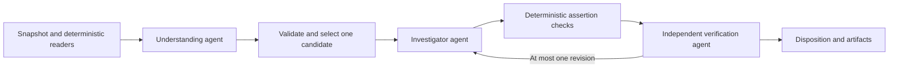

# Checkpoint 2B.1 — mechanism investigation

The existing scanner and snapshot capture provenance once. Imports and
structure share parsed trees. The context reader gives documented purpose and
examples. The existing report checker handles import facts and scoped
interpretations, while the 2A graph records written calls, conservative
same-module candidates, conditions and excerpts. Neither establishes runtime
ordering. The original HTML and report-writer paths remain independent.



Each AI role gets a separate invocation, role instructions, bounded evidence
and an independently validated output. The independent reviewer sees the draft
and source packet, with no investigator conversation or tools. The coordinator
selects one candidate and permits at most one investigation/review revision.
The deterministic-only path exports measured evidence and records the three
roles as skipped. The design deliberately leaves unsupported runtime ordering
unresolved rather than converting import order or line order to execution.

## Run and inspect

```sh
mkdir -p .repolens-cache/checkpoint-2b1
.venv/bin/python -m repolens mechanisms https://github.com/sindresorhus/p-limit \
  --no-ai --expect-commit a8a6fbec4e0e866d6d779b10889bb4f5567e70eb \
  --out .repolens-cache/checkpoint-2b1/p-limit.json
.venv/bin/python -m repolens mechanisms https://github.com/pallets/flask \
  --provider gemini --max-calls 3 --expect-commit 49943b5a94413a530761350f04e896f76e8d620e \
  --out .repolens-cache/checkpoint-2b1/flask-ai.json \
  --trace-out .repolens-cache/checkpoint-2b1/flask.trace.json
```

Gemini reads `GEMINI_API_KEY`. Claude uses `--provider claude`,
`ANTHROPIC_API_KEY`, the existing writer dependency and a model selected
with `--model` or `ANTHROPIC_MODEL`. The command accepts a local path as
well as a GitHub URL. AI requires a clean, pinned snapshot. The expected
commit option rejects mismatches without modifying the checkout or
fetching a different revision. Missing credentials produce a failed run
with skip records and an actionable message. The deterministic path
still writes measured context and structural counts.

`artifacts.verification.steps` records each proposed step, mechanical
errors, semantic judgment and disposition. `artifacts.mechanism.steps`
contains only accepted typed or explicitly classified claims. A summary
is stored as `summary_draft` and is unsuitable as verified teaching copy.
The optional trace contains prompt data, evidence excerpts and replies
for local inspection. It is separate from the user-facing artifact and
does not contain the provider credential. Treat traces as source
material when sharing them.

## Contracts and limits

The version-1 run envelope stores compact snapshot identity, provider
metadata, budgets, stage/attempt records, terminal status and artifacts.
Understanding returns purpose, capabilities with evidence labels, key
concepts and a selected candidate. Each candidate carries rationale,
entry-entity IDs, source references and limitations. The mechanism
contains typed or explicitly classified steps, source IDs, scope,
syntactic conditions, and unknowns. The verifier returns one review
entry per step, with a status, rationale and missing evidence plus
bounded revision requests. Verification outputs contain deterministic
and semantic results separately. Evidence uses existing knowledge and
structure IDs wherever available. The retrieval layer also builds
snapshot-anchored short windows from documentation, manifests and test
source without executing those files.

The controller allows up to five calls, defaults to 11,000 reserved output
tokens across the run (up to 2,200 per call) and a 150,000-byte serialized
input bound per role. Bytes bound the evidence packet independently of
provider tokenizers. These are caps, not measured or billed token counts.
Provider calls have a configurable timeout and no automatic transport
retry in this layer. One investigator/reviewer revision can follow
excluded steps. A failed revision retains the earlier assessed result.
Ctrl-C during role execution records cancellation through the CLI.
Invalid schemas, mismatched refs and unavailable evidence fail closed.
The reviewer receives no draft-generation conversation, deterministic
verdict or presumed correct answer.

A matching written relationship can support an exact direction, source
location, scope and conditional context. An unresolved receiver stays
unresolved. The gate rejects import-as-behavior and execution-order
assertions. Test snippets support expectations only and the evidence
retrieval does not run tests from analyzed repositories. The reviewer
can reject overclaiming prose, while model agreement is semantic
assessment rather than proof. Retrieval is lexical and bounded.
Assignment/state-change inference, interprocedural control flow, runtime
order and exhaustive repository coverage are outside this implementation.

## Evaluation

The pre-change baseline was 42 Python passes, two expected failures and
10 frontend passes. This checkpoint added focused Python tests around
the actual flow, including a simulated Gemini HTTP transport, malformed
review handling and adversarial assertions. Real provider credentials
were absent. A requested Gemini run saved a failed artifact and reported
that `GEMINI_API_KEY` is needed, without making a network request.

Both deterministic CLI runs used the cached pinned commits. p-limit
reported 43 definitions, 476 calls (three static candidates, 473
unresolved) and four resolved imports. Flask reported 1,622 definitions,
3,961 calls (33 static candidates, 3,928 unresolved) and 269 resolved
imports. Each records all three roles as skipped.

The opt-in `tests/mechanism_eval.py` uses the same controller with
evaluator-supplied queries and programmed model replies. It does not
establish which behavior a live model would discover. On p-limit, the
packet surfaced the written `queue.dequeue().run` call at `index.js:23`
under the active-count and nonempty-queue guard. On Flask, it surfaced
`self.url_map.bind_to_request` at `src/flask/app.py:547–549` under the
request-present condition in a try body. Both targets stayed unresolved.
Both verification artifacts report `partial`: the measured call
assertion passed, while a programmed claim assigning it a runtime
predecessor was excluded despite reviewer approval. A separate synthetic
test recorded a semantic contradiction of “always executes” and accepted
a revised guarded claim. These are controlled disagreements.

```sh
PYTHONPATH=. .venv/bin/python tests/mechanism_eval.py .repolens-cache/checkpoint-2b1
```

The next measurement should be a bounded live evaluation with independent
manual review of candidate usefulness, evidence retrieval and semantic
false positives across fresh cases. That can establish the reliability
needed before handing mechanism output to a story planner.
